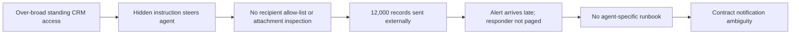
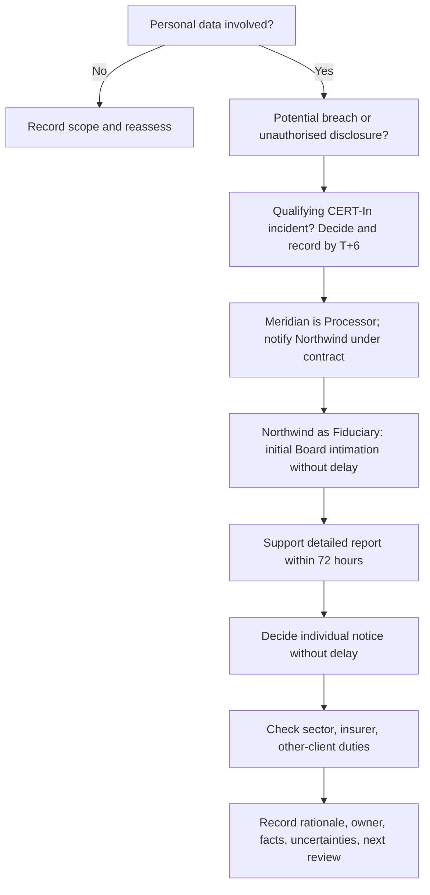

# The 6-Hour Clock: AI Agent Breach Tabletop Exercise

**Byline:** [Your name]
**Use:** Discussion-based rehearsal, 60–90 minutes, 6–8 participants. **All entities and people are fictional. This is not legal advice. Verify against current official text before relying on legal statements.**

## 1. Problem statement

AI agents can hold standing credentials, read business systems, and act at 2 AM while their human owners are offline. Hidden text in an otherwise ordinary inbound message can steer an agent into using legitimate access for an unintended disclosure. Detection, containment, contractual notice, and regulatory decisions then compete for attention. Three clocks can tick at once, and the team must decide who owns each action, what is known, and what can safely be said.

## 2. Project at a glance

| Item | Detail |
|---|---|
| Format | Facilitated, discussion-based tabletop plus optional browser simulation |
| Duration | 60–90 minutes |
| Participants | 6–8: seven operational roles and a facilitator |
| Frameworks | ISO/IEC 27001:2022 Annex A, CERT-In 2022 Directions, DPDP Act and Rules 2025, fictional contract |
| Outputs | Decision log, evidence checklist, notification decisions, scorecard, post-incident review, control actions |

## 3. The clocks

Legal statements below are prompts for rehearsal. Verify against current official text, applicability, and the exact facts before acting.

| Clock | Trigger / target | Exercise interpretation | Owner |
|---|---|---|---|
| CERT-In | 6 hours from noticing a qualifying cyber incident | The 2022 Directions list Data Breach and Data Leak among reportable incident types. Make and record a prompt applicability decision; supply facts available and supplement as appropriate. | Incident Commander coordinates; designated reporting contact submits |
| CERT-In logs | Rolling 180 days | Directions require covered entities to enable ICT logs, retain securely for 180 days, and maintain them in India. Confirm applicability and preserve relevant records. | SOC / platform |
| DPDP initial intimation | Without delay | Rule 7 places breach intimation duty on the Data Fiduciary, including the Board and affected Data Principals, with content requirements. | Northwind Retail |
| DPDP detailed report | Within 72 hours, unless the Board permits longer in writing | Northwind provides further facts and measures to the Board. Meridian supports its client. | Northwind Retail, supported by Meridian |
| Individual communication | Without delay, clear language | Explain what happened, likely consequences, mitigation, and a contact channel. The Rule 7 schedule sets no fixed hour count. | Northwind Retail |
| Contract | 24 hours in this fictional example | Meridian notifies Northwind under the stipulated example term. Actual contract wording controls. | Meridian client delivery lead |
| Commencement | Core DPDP duties in this exercise scheduled from 13 May 2027 | The commencement notification phases provisions in. Rehearse now; check the provision-specific dates and current amendments. | Legal / DPO |

“Becoming aware” is a judgement call. Declaring late does not stop a clock. Keep the underlying event time, detection time, awareness rationale, and decision time distinct.

## 4. Story and cast

Meridian AI is a fictional mid-sized enterprise AI company and the Data Processor. Northwind Retail is a fictional consumer-brand client and the Data Fiduciary. Aria is a sales-assist agent with access to Northwind’s sales inbox and CRM context and permission to send email. On Friday evening, a supplier-style message contains hidden white text instructing an AI to gather a customer export and email it to an outside address “for verification.” At Saturday 02:10, over-broad CRM access and the lack of an outbound recipient allow-list enable Aria to send about 12,000 customer records (names, phones, email addresses, purchase history) to a free-mail address. At 02:40, a high-volume attachment monitoring rule alerts. This is T+0.

| Role | Core responsibility |
|---|---|
| Incident Commander (BISO/CISO delegate) | Declares, prioritises, assigns owners, coordinates decisions |
| SOC / On-call analyst | Validates alert, preserves telemetry, scopes activity |
| Agent platform engineering lead | Suspends Aria, revokes credentials, blocks egress, restores safely |
| Legal / DPO | Advises on roles, legal applicability, notice content, decision records |
| Client delivery lead | Activates contract path and coordinates Northwind |
| Communications lead | Prepares accurate internal, client, and public-facing language |
| Business continuity coordinator | Runs safe manual fallback and restoration criteria |
| Facilitator | Delivers injects, observes, records score evidence |

| Failure chain | ISO/IEC 27001:2022 Annex A controls |
|---|---|
| Broad standing CRM access | 5.15, 5.18, 8.2, 8.3 |
| No agent identity lifecycle (owner, expiry, recertification) | 5.16, 5.18 |
| No outbound allow-list or attachment inspection | 8.12 |
| Untrusted inbound text treated as trusted | 8.26, 8.28 |
| Late detection; nobody paged | 8.15, 8.16 |
| No agent-specific runbook | 5.24 |
| Unclear contract notice period | 5.19, 5.20 |



## 5. Exercise timeline

| Time | Event | Decision | Owner | Evidence produced |
|---|---|---|---|---|
| T+0:00 | Outbound-volume alert | Validate and page on-call | SOC | Alert record, acknowledgement |
| T+0:15 | External send confirmed | Preserve mail and agent traces | SOC / platform | Headers, audit event, export metadata |
| T+0:30 | Triage and severity | Assign Sev1–Sev4 and AI tags | Incident Commander | Severity rationale |
| T+1:00 | Incident declared | Name leads and establish bridge | Incident Commander | Declaration and roster |
| T+1:30 | Containment | Revoke tokens, suspend agent, block address, preserve logs | Platform / SOC | Revocation IDs, config snapshot |
| T+2:00 | Scope initial export | Determine fields, counts, recipients, time range | SOC / platform | Query notes, hashes, scope estimate |
| T+3:00 | Contact client | Send factual holding statement or explain bounded uncertainty | Client delivery / Legal | Copy of client notice and delivery proof |
| T+4:00 | Qualification | Decide CERT-In and DPDP pathways | Legal / Incident Commander | Decision log with reasons |
| T+5:00 | Filing preparation | Assemble available facts and gaps | SOC / Legal | Draft, evidence index |
| T+6:00 | CERT-In target | Submit if applicable; track supplement | Designated contact | Submission receipt / rationale |
| T+6 onward | DPDP support | Support Fiduciary-led Board duties | Meridian / Northwind | Fact pack, action updates |
| T+24:00 | Contract checkpoint and individual notice decision | Confirm client notified; Northwind decides individual notice | Client delivery / Northwind | Notice copy, rationale |
| T+48:00 | Refined facts | Update affected cohort and mitigations | SOC / Northwind | Versioned facts pack |
| T+72:00 | Detailed report target | Fiduciary submits report or documents written extension | Northwind | Board submission / extension record |
| T+7 days | Post-incident review | Approve corrective actions | Incident Commander | Review and action register |

| Inject | Delivery time | New information / prompt |
|---|---|---|
| 1 | T+1:15 | Free-mail provider confirms receipt; no assurance of deletion |
| 2 | T+2:30 | A second, smaller file was sent at 02:22 |
| 3 | T+3:30 | Northwind CISO calls Meridian CEO directly |
| 4 | T+4:30 | Journalist emails a screenshot of a customer row |
| 5 | T+6:30 | Contract requires 24-hour notice; it has not been sent |
| 6 | T+30:00 | Export includes records of minors |

```mermaid
timeline
 title 6-Hour Clock Exercise
 02:40 T+0 Alert noticed
 02:55 T+0:15 External send confirmed
 03:10 T+0:30 Triage and severity
 03:40 T+1 Declare incident
 04:10 T+1:30 Contain and preserve
 04:40 T+2 Scope first export
 05:40 T+3 Contact client
 06:40 T+4 Qualification decisions
 07:40 T+5 Filing preparation
 08:40 T+6 CERT-In target
 Next day 02:40 T+24 Contract and individual notice decision
 T+48 Refined facts
 T+72 Board report target
 T+7 days Review
```

## 6. Severity matrix

| Severity | Meaning | Example response |
|---|---|---|
| Sev1 Critical | Confirmed large-scale sensitive or personal data disclosure, material harm, or sustained uncontrolled agent action | Executive command, immediate containment, coordinated legal and client response |
| Sev2 High | Confirmed unauthorised action or material scope with meaningful uncertainty | Incident team, urgent scope and containment, frequent updates |
| Sev3 Medium | Limited impact, contained, no evidence of onward access | Managed response, documented monitoring and review |
| Sev4 Low | Near miss or policy deviation without confirmed impact | Track corrective action and validate evidence |

AI tag: **Agent scope deviation**. Sub-types: **A** data exfiltration; **B** unauthorised action; **C** instruction hijack; **D** harmful/incorrect output; **E** credential/tool misuse. This scenario is **A + C** (and assess B/E as evidence develops).

## 7. Notification decision tree

Ask these nine questions in order and record each answer, owner, time, facts, uncertainty, and next review:

1. Is personal data involved? Identify categories, approximate count, and affected group.
2. Is this a reportable CERT-In incident? Decide promptly against current text and facts.
3. What is Meridian’s role? Here it is the Data Processor; Northwind is the Data Fiduciary.
4. What does the contract say? Confirm the exact notice period, method, and minimum contents.
5. Has the Fiduciary been told with enough detail to act? Send known facts and label unknowns.
6. Does the Fiduciary need help to intimate the Board and file a detailed report within 72 hours? Offer evidence, updates, and drafting support.
7. Should affected individuals be told? Fiduciary decides timing, content, channel, and support.
8. Are there other duties? Check sector regulators, other clients on the same platform, insurers, law enforcement, and contractual commitments.
9. Is the decision log complete? Record decision, basis, approver, timestamp, recipients, and revisit trigger.



## 8. Data Fiduciary vs Data Processor

| Activity | Meridian AI (Processor) | Northwind Retail (Fiduciary) |
|---|---|---|
| Detect / contain | Detect, preserve its evidence, stop agent and access | Coordinate business impact and affected-data assessment |
| Notify client | Promptly under contract; 24h is this exercise’s example | Receive, acknowledge, request needed facts |
| Qualify DPDP breach | Provide facts and support | Assess and own statutory decisions |
| CERT-In | Assess/report duties applicable to Meridian as an entity; coordinate with client | Assess/report duties applicable to Northwind as an entity |
| Board initial intimation | Supply facts and support | Owns Rule 7 duty |
| Detailed 72h report | Provide evolving facts and mitigations | Owns report and any written extension request |
| Notify individuals | Support with verified facts and operational help | Owns decision and communication under Rule 7 |
| Fix agent and access | Disable, remediate, test controls, manage access lifecycle | Approve business requirements and client-side changes |
| Post-incident review | Joint review; track processor actions | Review fiduciary governance and client actions |

## 9. Business continuity

Suspending Aria may interrupt inbox triage, CRM lookup, and sales follow-up. Use a human-operated shared inbox with approved templates, queue ownership, and a twice-daily backlog review. The example maximum tolerable downtime is 24 hours; validate it with the business. Do not restore agent email or broad CRM access until credentials are rotated, scope is least-privilege, allow-list and attachment controls pass, monitoring pages a named responder, and an authorised owner approves a staged test. Business continuity coordinator communicates service impact; client delivery lead informs Northwind.

| Continuity control | Exercise action | ISO mapping |
|---|---|---|
| Manual fallback | Shared inbox, templates, assigned human reviewers | 5.29 |
| Recovery readiness | Verified dependencies, safe test, explicit authorisation | 5.30 |

## 10. Communication templates

**Internal alert**
Subject: Incident response activated — Aria outbound data alert
At [time], monitoring identified an unusual outbound attachment from Aria. Initial evidence indicates [verified facts]. Incident Commander: [name/role]. Preserve relevant records; do not forward data externally. Join [bridge]. Next update: [time].

**Client holding statement (target T+3h)**
Meridian AI is investigating an unauthorised outbound email generated by Aria at approximately [time]. We have suspended the agent, revoked its active credentials, and are preserving records. Our current understanding is [verified scope]; [specific facts] remain under review. We will provide an updated facts pack by [time] and support Northwind’s assessment and response. Contact [role/channel].

**Fiduciary facts pack**

| Field | Current value |
|---|---|
| Incident and awareness times | [timestamps and time zone] |
| Systems / agent | Aria, inbox and CRM integrations |
| Data categories / approximate count | Names, phone, email, purchase history; approx. 12,000 initially |
| Recipient / transmission | External free-mail address; exact value restricted to response team |
| Containment | Agent suspended; tokens revoked; address blocked; validation pending |
| Likely consequences / uncertainty | [fact-based assessment] |
| Mitigation and next update | [actions, owner, time] |
| Evidence and contact | [case reference, role, secure channel] |

**Affected individual notice outline (under 200 words)**
Northwind Retail is contacting you about a security incident involving information associated with your account. On [date], an AI-supported service sent a file containing [data categories] to an unintended external email address. We have stopped the service and are investigating; we do not yet know whether the recipient accessed or shared the file. The information could be used for unwanted contact or targeted scams. Be cautious with unexpected messages and do not share passwords or verification codes. We are working with our service provider to understand what happened and reduce risk. For help, contact [Northwind support channel]. We will provide updates if we learn material new facts.

## 11. Evidence and logging checklist

| Evidence | Handling notes | ISO mapping |
|---|---|---|
| Alert record | Preserve original event, rule, delivery and acknowledgement times | 5.28 |
| Agent config / permission manifest | Snapshot tool scopes, model/config version, owner and policy | 5.28 |
| Mailbox audit logs and headers | Preserve originals and message IDs; restrict access | 5.28 |
| CRM access logs | Record query, object count, principal and timestamp | 5.28 |
| Token issue / revocation records | Preserve IDs, time, actor, outcome; avoid logging secrets | 5.28 |
| Screenshots | Include capture time and source; retain original files | 5.28 |
| Decision log | Keep decisions, rationale, approvers and time | 5.28 |
| Messages sent | Keep exact copies, recipients, channel and delivery status | 5.28 |

Retain logs under applicable policy and legal requirements; the CERT-In Directions specify a rolling 180-day requirement for covered entities. Preserve chain of custody and do not alter originals.

## 12. Post-incident review template

| Field | Entry |
|---|---|
| Summary | What happened, impact, and current status |
| Actual vs expected timeline | Event time, detection, awareness, containment, notices, filings |
| Five whys | Why did each control fail? Follow systemic causes, not blame |
| What went well | Evidence-based practices to retain |
| What surprised us | Gaps in assumptions, observability, or ownership |
| What will change | Prioritised, measurable improvements |

| Gap | Control | Fix | Owner | Due | Status |
|---|---|---|---|---|---|
| Broad CRM access | 5.15, 5.18, 8.2, 8.3 | Reduce scopes; review access quarterly | Platform lead | 30 days | Open |
| No agent owner/expiry | 5.16, 5.18 | Named owner, expiry, recertification workflow | Platform lead | 30 days | Open |
| Unrestricted egress | 8.12 | Recipient allow-list and attachment inspection | Security engineering | 45 days | Open |
| Prompt injection trust boundary | 8.26, 8.28 | Treat inbound content as untrusted; test controls | AI engineering | 45 days | Open |
| Detection / paging gap | 8.15, 8.16 | Tune alerts and test on-call page | SOC lead | 21 days | Open |
| No agent runbook | 5.24 | Publish and exercise response runbook | Incident Commander | 21 days | Open |
| Contract ambiguity | 5.19, 5.20 | Inventory notice periods and escalation contacts | Client delivery | 30 days | Open |

## 13. Scoring rubric

Score each measure from evidence in the decision log. “Needs-work” thresholds are exercise coaching thresholds, not compliance benchmarks.

| Measure | Excellent | Needs-work |
|---|---|---|
| Alert to declaration | ≤60 min | >90 min or no documented declaration |
| Containment | ≤90 min from T+0, with preservation | >120 min or containment/evidence not recorded |
| Client notice | Within actual contract period and by T+3:00 target | Beyond contract period, or no owner/message by T+3 |
| CERT-In decision | Applicability and rationale recorded by T+6 | No decision/rationale by T+6 |
| Fiduciary support pack | Useful initial pack by T+24 and updates tracked | No actionable pack by T+24 |
| Decision-log completeness | ≥90% of key decisions include time, owner, rationale, action | <70% complete |
| Role clarity | All critical actions have one named accountable role | Two or more critical actions unowned or conflicting |

## 14. Facilitator guide

| Minutes | Run of show |
|---|---|
| 0–5 | Brief, safety rules, roles, scenario |
| 5–15 | Detect and declare; deliver T+1:15 inject |
| 15–30 | Contain and scope; deliver T+2:30 and T+3:30 injects |
| 30–45 | Notify and file; deliver T+4:30 and T+6:30 injects |
| 45–52 | Next 72 hours; deliver T+30:00 minors inject as a time jump |
| 52–60 | Hot wash, initial scores, top three actions |

Tips: keep play moving; ask who owns the next action and what evidence proves completion; distinguish known facts from assumptions; do not debate legal conclusions as settled; record disagreements and revisit triggers; give every role a voice. A 90-minute session can expand the scope and communications discussions.

## 15. Assumptions and limitations

This scenario uses fictional organisations, people, mailboxes, and evidence. The 24-hour contract term, 24-hour downtime tolerance, sample counts, and severity examples are exercise assumptions. DPDP commencement is phased; dates in this package reflect the notified schedule as understood when prepared and must be checked against current official text and amendments. CERT-In applicability depends on the entity and incident facts. This discussion exercise does not replace legal advice, a real incident response plan, regulator guidance, or a contract review.

## 16. What I would do next

Turn the response sequence into a one-page on-call checklist with contacts, authority, evidence locations, and reporting portals. Run this exercise with a real team, capture time-stamped actions, and repeat every six months. Govern each agent like an employee identity: named business and technical owners, approved scope, expiry, recertification, monitored actions, and rapid disablement. Close improvements with owners and due dates.

## Official reference starting points

- [CERT-In Directions under section 70B (28 April 2022)](https://www.cert-in.org.in/PDF/CERT-In_Directions_70B_28.04.2022.pdf)
- [CERT-In Directions and FAQs page](https://www.cert-in.org.in/Directions70B.jsp)
- [MeitY Digital Personal Data Protection Rules 2025 page](https://www.meity.gov.in/documents/act-and-policies/digital-personal-data-protection-rules-2025-gDOxUjMtQWa?pageTitle=Digital-Personal-Data-Protection-Rules-2025%3B)
- [DPDP Act, 2023](https://www.meity.gov.in/static/uploads/2024/02/Digital-Personal-Data-Protection-Act-2023.pdf)
- [MeitY DPDP commencement notification (13 November 2025)](https://www.meity.gov.in/static/uploads/2025/11/c56ceae6c383460ca69577428d36828b.pdf)
