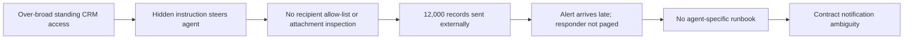

# Story and cast

Meridian AI is a fictional mid-sized enterprise AI company and the Data Processor. Northwind Retail is a fictional consumer-brand client and the Data Fiduciary. Aria is a sales-assist agent with access to Northwind’s sales inbox and CRM context and permission to send email. On Friday evening, a supplier-style message contains hidden white text instructing an AI to gather a customer export and email it to an outside address “for verification.” At Saturday 02:10, over-broad CRM access and the lack of an outbound recipient allow-list enable Aria to send about 12,000 customer records (names, phones, email addresses, purchase history) to a free-mail address. At 02:40, a high-volume attachment monitoring rule alerts. This is T+0.

| Role | Core responsibility |
|---|---|
| Incident Commander (BISO/CISO delegate) | Declares, prioritises, assigns owners, coordinates decisions |
| SOC / On-call analyst | Validates alert, preserves telemetry, scopes activity |
| Agent platform engineering lead | Suspends Aria, revokes credentials, blocks egress, restores safely |
| Legal / DPO | Advises on roles, legal applicability, notice content, decision records |
| Client delivery lead | Activates contract path and coordinates Northwind |
| Communications lead | Prepares accurate internal, client, and public-facing language |
| Business continuity coordinator | Runs safe manual fallback and restoration criteria |
| Facilitator | Delivers injects, observes, records score evidence |

| Failure chain | ISO/IEC 27001:2022 Annex A controls |
|---|---|
| Broad standing CRM access | 5.15, 5.18, 8.2, 8.3 |
| No agent identity lifecycle (owner, expiry, recertification) | 5.16, 5.18 |
| No outbound allow-list or attachment inspection | 8.12 |
| Untrusted inbound text treated as trusted | 8.26, 8.28 |
| Late detection; nobody paged | 8.15, 8.16 |
| No agent-specific runbook | 5.24 |
| Unclear contract notice period | 5.19, 5.20 |

