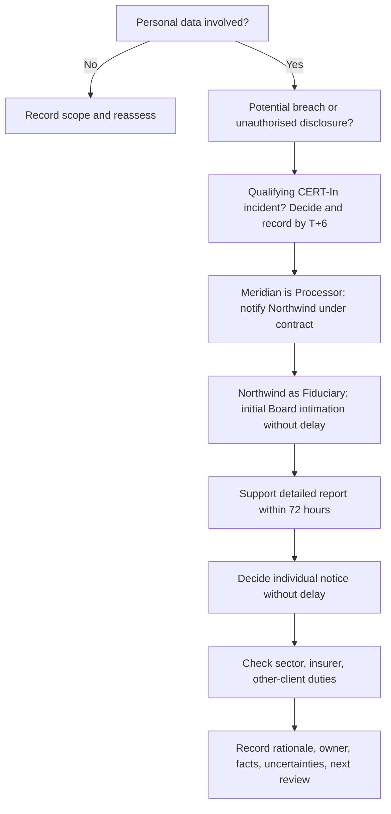

# Notification decision tree

Ask these nine questions in order and record each answer, owner, time, facts, uncertainty, and next review:

1. Is personal data involved? Identify categories, approximate count, and affected group.
2. Is this a reportable CERT-In incident? Decide promptly against current text and facts.
3. What is Meridian’s role? Here it is the Data Processor; Northwind is the Data Fiduciary.
4. What does the contract say? Confirm the exact notice period, method, and minimum contents.
5. Has the Fiduciary been told with enough detail to act? Send known facts and label unknowns.
6. Does the Fiduciary need help to intimate the Board and file a detailed report within 72 hours? Offer evidence, updates, and drafting support.
7. Should affected individuals be told? Fiduciary decides timing, content, channel, and support.
8. Are there other duties? Check sector regulators, other clients on the same platform, insurers, law enforcement, and contractual commitments.
9. Is the decision log complete? Record decision, basis, approver, timestamp, recipients, and revisit trigger.

